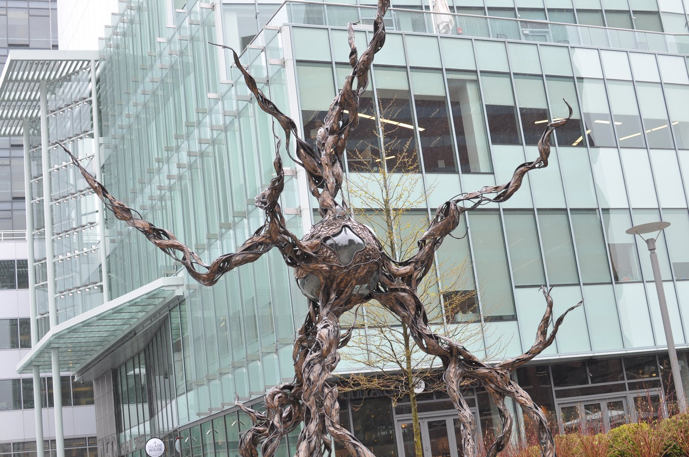
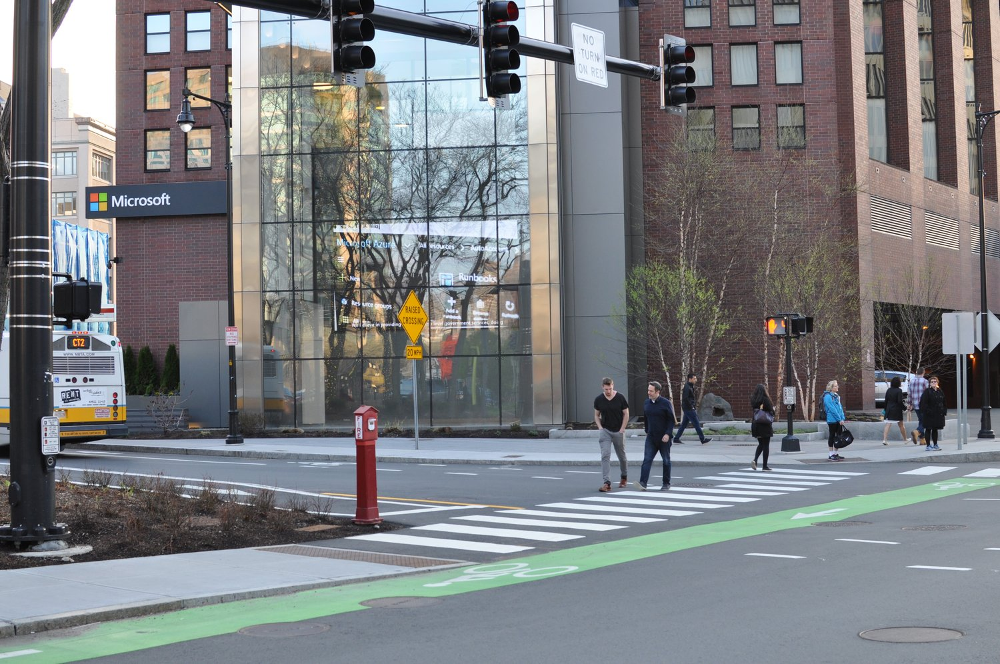



I'm a **Senior Software Engineer** with 8+ years building backend, data and AI systems in **Python and Java** &mdash; from cloud infrastructure to web front ends &mdash; for banking, automotive and cybersecurity. I've worked with **Deloitte, Huawei, BMW and Samsung**, and I hold an M.Sc. in Computer Science (Artificial Intelligence) from **TU Munich**, with my final semester as a visiting student at **MIT**.

**Selected impact:**

- At **Deloitte**, led the CI/CD team on a **150-million-line** COBOL-to-Java mainframe migration &mdash; release time **2 weeks &rarr; 1 day**.
- Built an AI tool translating a bank's HiveQL to BigQuery &mdash; **&minus;56%** manual effort across 207 scripts.
- At **Huawei**, built an NLP pipeline in Python that crawls, parses, annotates and classifies **100,000+** security articles into STIX objects for cyber-security intelligence, with human-in-the-loop validation.
- Shipped the test automation for the Intel modem used in the **Apple iPhone 7**.

These days I build software with **agentic AI coding** day to day. My largest personal project, **Turtle**, is a live algorithmic-trading research platform developed almost entirely through agentic coding, built around a **MetaTrader&nbsp;5 validation harness** (with an ML entry filter in research) &mdash; see the [Financial Trading Software](/portfolio/1-trading-software/) page, or [how I work](/approach/).

**Explore:** [Portfolio](/portfolio/) &middot; [How I Work](/approach/) &middot; [Publications](/publications/) &middot; [CV](/cv/)

[GitHub](https://github.com/zeecitizen) &middot; [LinkedIn](https://www.linkedin.com/in/mohammadzeeshan) &middot; m.zeeshan@tum.de

---

## A few moments at MIT

  
  
  
  
  
  
  
  
  
  
  
  

