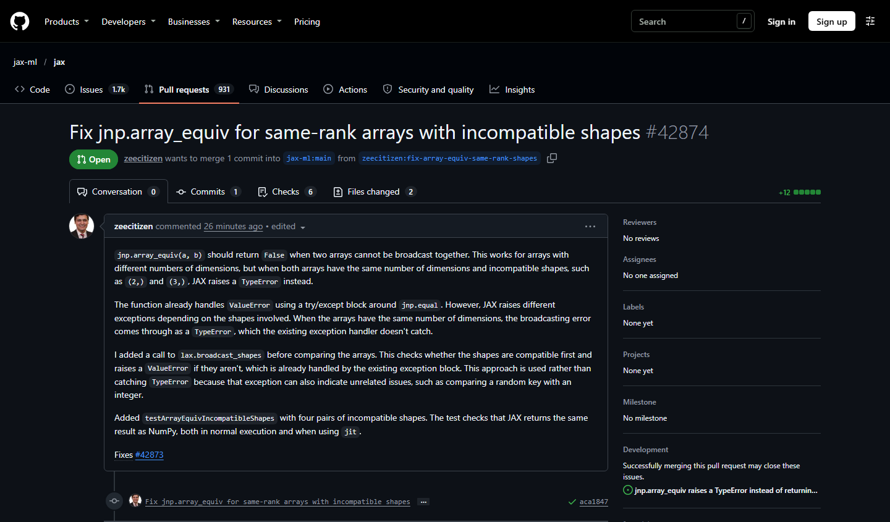
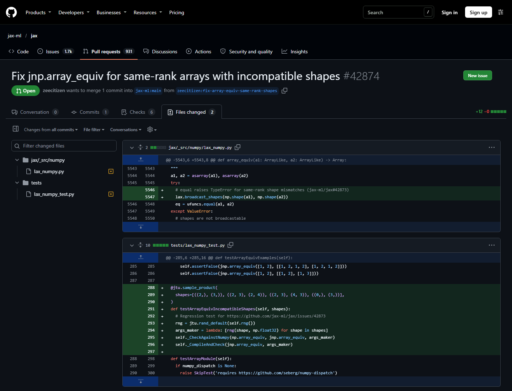
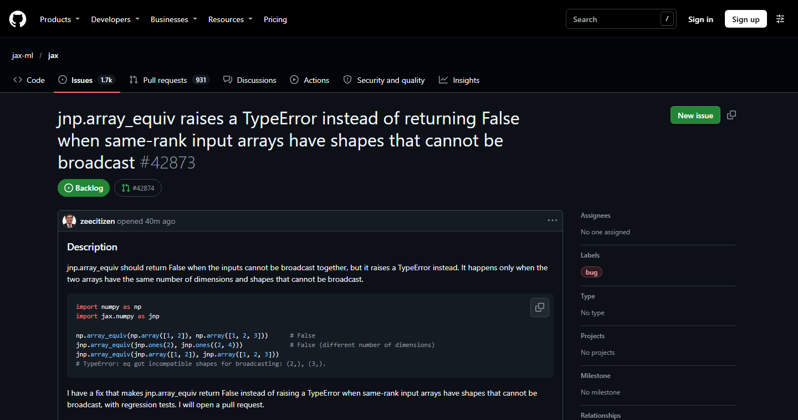
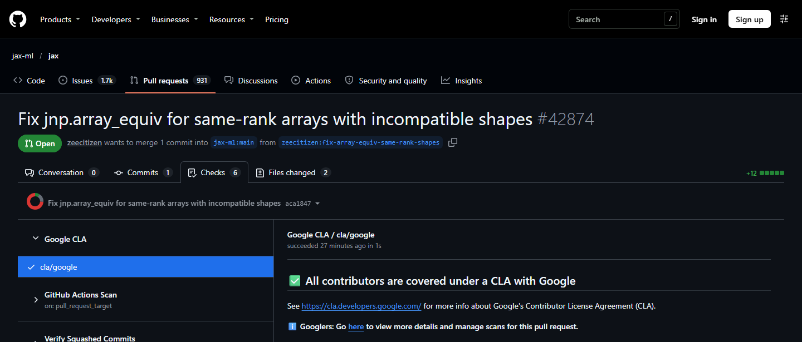



<div class="dexter-lab" markdown="1">

Three contributions to public codebases, newest first: two fixes awaiting review, in JAX and in NASA's OnAIR, and my 2017 work on the platform behind MIT's Climate CoLab.

- [**JAX** (2026)](#jax): an open pull request with a one-line fix to `jax.numpy.array_equiv`. JAX is the numerical computing library developed mainly at Google.
- [**NASA OnAIR** (2026)](#nasa-onair): an open pull request fixing telemetry data loss in the Redis adapter.
- [**MIT XCoLab** (2017)](#mit-xcolab): 56 commits on the collaboration platform of the MIT Center for Collective Intelligence, including a site-wide notifications feature.

## JAX (2026) {#jax}

<span class="lab-badge">JAX &middot; pull request open</span>

**A one-line fix in JAX**, the open-source library for numerical computing and machine-learning research developed mainly at Google. `jax.numpy.array_equiv` raised an error in a case where its own documentation, and NumPy, say the answer is `False`. The pull request was opened on 25&nbsp;November&nbsp;2026 and is awaiting review by the maintainers. It has not been merged.

<a class="lab-btn" href="https://github.com/jax-ml/jax/pull/42874">Pull request #42874 on GitHub &rarr;</a>

<div class="lab-stats">
  <div class="lab-stat"><b>+12 lines</b><span>2 in the function, 10 of regression test</span></div>
  <div class="lab-stat"><b>4 of 4</b><span>new test cases fail before the fix, pass after</span></div>
  <div class="lab-stat"><b>722 checks</b><span>against NumPy: 120 raised an error before, none after</span></div>
  <div class="lab-stat"><b>JAX 0.12.1</b><span>the current release has the bug too</span></div>
</div>

### The project {#jax-the-project}

[JAX](https://github.com/jax-ml/jax) is, in its own words, "a Python library for accelerator-oriented array computation and program transformation, designed for high-performance numerical computing and large-scale machine learning". It is developed mainly at Google, describes itself as a research project and not an official Google product, and takes outside contributions under Google's contributor agreement.

Its `jax.numpy` module re-implements NumPy's interface, so that code written for NumPy can be differentiated, compiled and run on accelerators. It aims to match NumPy, and documents the places where it deliberately does not.

### The bug {#jax-the-bug}

`array_equiv(a, b)` answers one question: are these two arrays equal, if broadcasting is allowed? When the shapes cannot be broadcast at all, the answer is `False`. JAX's documentation says so, and that is what NumPy returns. JAX did this only when the two arrays had a different number of dimensions:

| Shapes compared | NumPy | Unmodified JAX | With the fix |
|---|---|---|---|
| `(2,)` and `(2, 4)` | `False` | `False` | `False` |
| `(2,)` and `(3,)` | `False` | *TypeError* | `False` |
| `(2, 3)` and `(2, 4)` | `False` | *TypeError* | `False` |

```python
import numpy as np
import jax.numpy as jnp

np.array_equiv(np.array([1, 2]), np.array([1, 2, 3]))
# False
jnp.array_equiv(jnp.array([1, 2]), jnp.array([1, 2, 3]))
# TypeError: eq got incompatible shapes for broadcasting: (2,), (3,).
```

The function compared the arrays inside a `try` and treated a `ValueError` as "these shapes do not fit". JAX raises `ValueError` when the numbers of dimensions differ. When they are the same, the error comes from the lower-level comparison in `jax.lax` and is a `TypeError`, which went straight past the `except`. The existing tests for this function use shapes that can be broadcast, or shapes with different numbers of dimensions, so this case was not covered. The bug is in the current release, 0.12.1, as well as on the main branch.

### The fix {#jax-the-fix}

```diff
   a1, a2 = asarray(a1), asarray(a2)
   try:
+    # equal raises TypeError for same-rank shape mismatches (jax-ml/jax#42873)
+    lax.broadcast_shapes(np.shape(a1), np.shape(a2))
     eq = ufuncs.equal(a1, a2)
   except ValueError:
     # shapes are not broadcastable
     return array(False)
```

Before comparing, the function now asks JAX whether the two shapes can be broadcast. That helper raises `ValueError` for any pair that cannot, whatever the number of dimensions, and the `except` that was already there turns it into `False`. NumPy's own `array_equiv` is built the same way: check the shapes, then compare.

### Why not the obvious fix {#jax-why-not-the-obvious-fix}

The obvious fix is to catch `TypeError` as well. That was the first version, and it passed everything: all 722 comparisons against NumPy and the whole test file. It had a side effect. JAX also raises `TypeError` for mistakes that have nothing to do with shapes, and the wider `except` turned these three into a silent `False`:

| Input | Unmodified JAX | Wider except | With the fix |
|---|---|---|---|
| shapes `(2,)` and `(3,)` | *TypeError* | `False` | `False` |
| a value that escaped from a compiled function (a leaked tracer) | error | *`False`* | error |
| two arrays of `float0`, the type JAX uses for gradients of integers | error | *`False`* | error |
| a random-number key compared with an integer | error | *`False`* | error |

A review by three separate AI agents, run before submission, caught this, and the fix was narrowed to the single line above. The three cases in the table stay errors. One side effect is known: with symbolic shapes (`jax.export`) that cannot be proved equal, the function now returns `False`, as `array_equal` already does, where it used to stop with the same error.

### How it was verified {#jax-how-it-was-verified}

- **Against NumPy, 722 comparisons.** Every ordered pairing of 19 shapes (361 pairs), from scalars and empty arrays up to three dimensions, each with equal and with different values. In JAX's default configuration, the unmodified code agreed with NumPy on 602 and raised on the other 120, all of them pairs with the same number of dimensions. With the fix it agrees on all 722.
- **A regression test that fails when it should.** The new test does not assert `False`. It compares four incompatible shape pairs with NumPy's answer, with and without `jit`, JAX's compiler. All four fail on unmodified JAX with the same kind of `TypeError`, and pass with the fix.
- **Errors that should stay errors.** The three unrelated cases in the table above still raise as before.
- **The whole test file.** JAX's main NumPy test file (`tests/lax_numpy_test.py`) still passes with the change: 3,413 tests with the default 32-bit types and 3,453 with 64-bit types enabled.

**Still pending:** JAX's own CI has not run on the pull request yet, because runs from first-time contributors wait for a maintainer's approval. JAX's contributing guide adds that a larger set of tests, including GPU and TPU backends, starts only once a pull request has been reviewed. Of the automatic checks, Google's contributor-agreement check has run and passes. The numbers above are from my own machine (Windows, CPU only).

### How the bug was found {#jax-how-the-bug-was-found}

By comparing JAX with NumPy directly. A script ran 264 `jax.numpy` functions and their NumPy counterparts on awkward inputs: booleans, small integers, NaN and infinity, empty and zero-dimensional arrays, mismatched shapes. Most of the differences it reported come from JAX's different rules for result types, which are deliberate. This one contradicted the function's own documentation and had not been reported.

### Decisions that shaped it {#jax-decisions-that-shaped-it}

- **Follow the project's conventions.** An issue first ([#42873](https://github.com/jax-ml/jax/issues/42873)), then a single commit that refers to it, a parameterised test in the same form as the other regression tests in that file, and no change beyond the fix.
- **Small on purpose.** The change touches only the case in the issue. The review also noted that, under JAX's optional strict settings, this function returns `False` in some cases where NumPy returns `True`. That was already so, may be intended, and is left alone.

### How it was built {#jax-how-it-was-built}

As with the NASA fix below, I worked with an AI coding agent (Claude Code). The agent ran the comparison against NumPy that surfaced the bug, wrote the fix and the test, and ran the verification. That included the review by three separate agents, which found the problem with the first version of the fix. I read the change, ran the regression tests, wrote the issue and the pull request description in my own words (with grammar help), signed Google's contributor agreement, made the commit and submitted the pull request myself.

### Status {#jax-status}

- **Pull request [#42874](https://github.com/jax-ml/jax/pull/42874):** open since 25 November 2026, awaiting maintainer review.
- **Issue [#42873](https://github.com/jax-ml/jax/issues/42873):** open, linked to the pull request.

*Last updated 25 November 2026.*

### Screenshots {#jax-screenshots}

<div class="lab-gallery lab-gallery--compact">
  <figure class="lab-shot lab-shot--wide"><a href="/images/opensource/jax-pr-42874.png" target="_blank" rel="noopener"></a><figcaption>Pull request #42874 on jax-ml/jax &mdash; open, awaiting review &middot; click to enlarge</figcaption></figure>
  <figure class="lab-shot lab-shot--wide"><a href="/images/opensource/jax-diff.png" target="_blank" rel="noopener"></a><figcaption>The whole change: two lines in the function (a comment and the check) and a ten-line regression test</figcaption></figure>
  <figure class="lab-shot"><a href="/images/opensource/jax-issue-42873.png" target="_blank" rel="noopener"></a><figcaption>Issue #42873: the report and its reproduction. The issue is open; its status badge reads &ldquo;Backlog&rdquo;</figcaption></figure>
  <figure class="lab-shot"><a href="/images/opensource/jax-cla-check.png" target="_blank" rel="noopener"></a><figcaption>Google's contributor-agreement check on the pull request: passed. The test workflows have not run yet; they wait for a maintainer's approval</figcaption></figure>
</div>

---

## NASA OnAIR (2026) {#nasa-onair}

<span class="lab-badge">NASA OnAIR &middot; pull request open</span>

**A fix for a telemetry data-loss bug in NASA's OnAIR**, the open-source platform from NASA's Goddard Space Flight Center for running AI algorithms on spacecraft telemetry. The pull request was opened on 24&nbsp;November&nbsp;2026 and is awaiting review by the maintainers. It has not been merged.

<a class="lab-btn" href="https://github.com/nasa/OnAIR/pull/210">Pull request #210 on GitHub &rarr;</a>

<div class="lab-stats">
  <div class="lab-stat"><b>18 of 20 &rarr; 0</b><span>updates lost on real Redis, before &rarr; after</span></div>
  <div class="lab-stat"><b>374 tests</b><span>passing, 100% coverage</span></div>
  <div class="lab-stat"><b>Python 3.8&ndash;3.12</b><span>verified on Linux</span></div>
  <div class="lab-stat"><b>~10 lines</b><span>of source changed</span></div>
</div>

### The project

[OnAIR](https://github.com/nasa/OnAIR) (On-board Artificial Intelligence Research) is a Python pipeline that takes live telemetry from a spacecraft or a simulator and hands it, one frame at a time, to AI plugins that learn, plan and reason about it. NASA's [published account](https://doi.org/10.1002/aaai.70020) describes its use in research missions, including an experiment on a payload at the International Space Station.

The change described here is to the Redis data adapter in the open-source repository. It is not flight software, and nothing on this page has flown.

### The bug

OnAIR receives telemetry on a background thread and passes it to the pipeline in frames. The Redis adapter wiped its buffer every time a message arrived. So when two channels published between two frames, the second message erased the first before the pipeline ever saw it.

| | Channel A publishes | Channel B publishes | What the pipeline received |
|---|---|---|---|
| **Before** | x = 10 | x = 20 | A: *nothing*, B: 20 |
| **After** | x = 10 | x = 20 | A: 10, B: 20 |

A member of NASA's team had described the problem in [issue #189](https://github.com/nasa/OnAIR/issues/189) and suggested where the fix belonged: blank the buffer when the two buffers are swapped, not when a message arrives.

### The fix

Three lines in `get_next`, at the moment the buffers swap:

```python
with self.new_data_lock:
    self.new_data = False
    self.double_buffer_read_index = (self.double_buffer_read_index + 1) % 2
    read_index = self.double_buffer_read_index
    # turn all data points of the new write buffer to unknown
    write_buffer = self.current_data[(read_index + 1) % 2]
    write_buffer["data"] = ["-" for _ in write_buffer["data"]]
```

A frame now holds everything received since the previous frame, and the pipeline's existing logic keeps the older values. The per-message wipe is removed.

The second half is concurrency. The listener thread used to write its message without holding the lock. With blanking moved to the swap, a message caught half-way through a swap would have its second half written into a frame that had already been handed out, and lost. So the listener now holds the same lock for the whole message.

### How it was verified

- **Against real servers.** The project's own Redis example was run against two Redis 7.0 servers, with two channels publishing back to back 20 times. On the existing code the first channel's update was lost in 18 of the 20 pairs (20 of 20 in a second run). With the fix, none were lost in either run.
- **Tests that fail when they should.** One existing test encoded the bug and was corrected; three were added. All four fail against the old code. Three deliberately broken versions of the fix are each caught too: a nested lock, blanking in place, and setting the "new data" flag outside the lock.
- **A test for the deadlock nobody would see.** The existing tests replace the lock with a mock, so a version that takes the lock twice, and would freeze on the first real message, passes all of them. A new test asserts exactly one acquire, with the write inside it.
- **Under load.** With real threads and 20,000 messages under aggressive thread switching, the old code let 100 to 176 half-written messages into a frame per run. The fixed code let none. Those are stress conditions, not field rates.
- **The whole suite.** 374 tests pass with 100% statement and branch coverage, on Python 3.8 to 3.12 on Linux.

**Still pending:** NASA's own CI has not run on the pull request yet, because runs from first-time contributors wait for a maintainer's approval. The Linux results above are from my fork.

### Decisions that shaped it

- **The documentation settled the design.** The discussion around these adapters offered two approaches: blank the buffer, or carry old values forward inside the adapter. OnAIR's architecture document defines a frame as only the newly received data, and the pipeline already carries old values forward. Blanking at the swap is therefore the consistent fix, and it is the one NASA's team had suggested.
- **Small on purpose.** No refactoring, no new options, and the documentation page left alone. The pull request description is kept short.
- **One fix per pull request.** The same defect exists in mirror image in the adapter for NASA's cFS flight software ([issue #201](https://github.com/nasa/OnAIR/issues/201)): it never blanks, so consecutive frames alternate between two stale buffers. That fix is written and verified on my fork, with 374 tests passing on Python 3.8 to 3.12, but not submitted. The reporter of that issue had proposed a different approach, so I [raised the design question there](https://github.com/nasa/OnAIR/issues/201#issuecomment-7146645822) first. He [agreed with blanking](https://github.com/nasa/OnAIR/issues/201#issuecomment-7157138220) and will submit the change for that adapter himself, in the same form, so I [offered him my branch](https://github.com/nasa/OnAIR/issues/201#issuecomment-7165768924). It has not been run against cFS itself.
- **Found along the way.** NASA's CI has been failing on the main branch since 29 October 2026, because the hosted runner image no longer provides Python 3.8 or 3.9; the pull request notes it. One existing test also leaves a line uncovered about one run in ten, depending on a random number.

### How it was built

I work with an AI coding agent, and this contribution was built that way. The agent (Claude Code) did the code reading, wrote the change and its tests, and ran the verification. I chose the project and the issue, approved the approach, reviewed the change before it went out, signed NASA's contributor agreement and submitted the pull request myself. The commit lists Claude as co-author and the pull request says so, in line with the project's request that AI-assisted contributions are reviewed by a person.

### Status

- **Pull request [#210](https://github.com/nasa/OnAIR/pull/210):** open since 24 November 2026, awaiting maintainer review. NASA requires a signed contributor agreement, which I sent the same day.
- **Second fix (cFS/SBN adapter):** written and tested on my fork, and offered to the reporter of issue #201, who agreed with the approach and will submit that change himself.

*Last updated 25 November 2026.*

### Screenshots

<div class="lab-gallery lab-gallery--compact">
  <figure class="lab-shot lab-shot--wide"><a href="/images/opensource/onair-pr-210.png" target="_blank" rel="noopener"></a><figcaption>Pull request #210 on nasa/OnAIR &mdash; open, awaiting review &middot; click to enlarge</figcaption></figure>
  <figure class="lab-shot lab-shot--wide"><a href="/images/opensource/onair-issue-189.jpg" target="_blank" rel="noopener"></a><figcaption>Issue #189: the problem as NASA's team described it, my note of intent, and the linked pull request</figcaption></figure>
  <figure class="lab-shot"><a href="/images/opensource/onair-checks-redis-fix.jpg" target="_blank" rel="noopener"></a><figcaption>The fix on my fork: tests and lint on Python 3.8&ndash;3.12, plus the run against real Redis servers</figcaption></figure>
  <figure class="lab-shot"><a href="/images/opensource/onair-checks-baseline.jpg" target="_blank" rel="noopener"></a><figcaption>Baseline: NASA's unmodified code under the same checks (the Redis run here is the one that shows the loss)</figcaption></figure>
  <figure class="lab-shot"><a href="/images/opensource/onair-checks-sbn-fix.jpg" target="_blank" rel="noopener"></a><figcaption>The second fix (cFS/SBN adapter), on my fork and not submitted: tests and lint on Python 3.8&ndash;3.12</figcaption></figure>
  <figure class="lab-shot"><a href="/images/opensource/onair-readme.jpg" target="_blank" rel="noopener"></a><figcaption>OnAIR's README. The red &ldquo;failing&rdquo; badge is NASA's own CI, broken by the runner change noted above</figcaption></figure>
</div>

---

## MIT XCoLab (2017) {#mit-xcolab}

<span class="lab-badge">MIT XCoLab &middot; 56 commits</span>

**[XCoLab](https://github.com/CCI-MIT/XCoLab)** is the open-source platform behind MIT's [Climate CoLab](https://climatecolab.org), built to let large groups of people work together on proposals for complex problems. I worked on it in 2017 as a visiting student at the MIT Center for Collective Intelligence, where it was also the subject of my master's thesis.

<a class="lab-btn" href="https://github.com/CCI-MIT/XCoLab/commits?author=zeecitizen">All 56 commits on GitHub &rarr;</a>

<div class="lab-stats">
  <div class="lab-stat"><b>56 commits</b><span>March to June 2017</span></div>
  <div class="lab-stat"><b>11 files, 662 lines</b><span>the notifications feature</span></div>
  <div class="lab-stat"><b>Java &middot; Spring</b><span>microservices and web layer</span></div>
  <div class="lab-stat"><b>Arctic Code Vault</b><span>archived by GitHub, 2020</span></div>
</div>

### The strongest piece: site-wide notifications

A feature that lets an administrator publish a timed notice to everyone on the site (ticket COLAB-1701). It runs through the whole stack:

- **Admin microservice.** REST endpoints to create, list and delete notifications, each with a start and an end time. Expired ones are dropped.
- **Typed client.** A REST client for those endpoints in the `admin-client` module.
- **Web layer.** A controller that checks for administrator rights, and a screen in the admin tab to write and remove notices.
- **Browser.** A script that asks for the active notice every three minutes, shows it once, and remembers in a cookie that it was shown.

[Merged into the project's `develop` branch on 13 April 2017](https://github.com/CCI-MIT/XCoLab/commit/d006bf7b7a724f5643b205c04442c513ede2a86e): 11 files, 662 lines added.

<figure class="lab-shot lab-shot--block"><a href="/images/opensource/xcolab-notifications-commit.png" target="_blank" rel="noopener"></a><figcaption>The notifications feature landing in XCoLab: 11 files across the admin microservice, its client and the web layer &middot; click to enlarge</figcaption></figure>

### Fixes across the platform

A selection of the others, each tied to a ticket in the project's tracker:

- **Linked proposals showed generic names instead of their own** ([COLAB-1915](https://github.com/CCI-MIT/XCoLab/commit/35133966bc)).
- **A message sent to several people appeared twice in the sender's mailbox** ([COLAB-1605](https://github.com/CCI-MIT/XCoLab/commit/f685b3c67f)).
- **Members with more than one role were listed several times** ([COLAB-1339](https://github.com/CCI-MIT/XCoLab/commit/da34e91f43)).
- **Mass messaging:** certain accounts excluded from the recipient list ([COLAB-1881](https://github.com/CCI-MIT/XCoLab/commit/39cd47fba0)).
- **Facebook sign-in:** corrected conditions in the registration flow ([COLAB-192](https://github.com/CCI-MIT/XCoLab/commit/67791856c4)).

The remaining commits are small interface and wording fixes, and 16 of the 56 are merge commits.

### How this work was done

These commits went in through the team's normal workflow: feature branches named after tickets, merged into `develop`, with commit access as a member of the team. They are not outside pull requests. They date from 2017, well before AI coding agents.

### Preserved in the Arctic Code Vault

In 2020 GitHub's Archive Program stored a snapshot of public repositories in a vault in Svalbard. XCoLab was among them, and contributors to the archived repositories carry the Arctic Code Vault badge on their GitHub profile.

<figure class="lab-shot lab-shot--inline"><a href="/images/opensource/arctic-code-vault-badge.png" target="_blank" rel="noopener"></a><figcaption>The Arctic Code Vault badge on my GitHub profile, for XCoLab</figcaption></figure>

</div>
