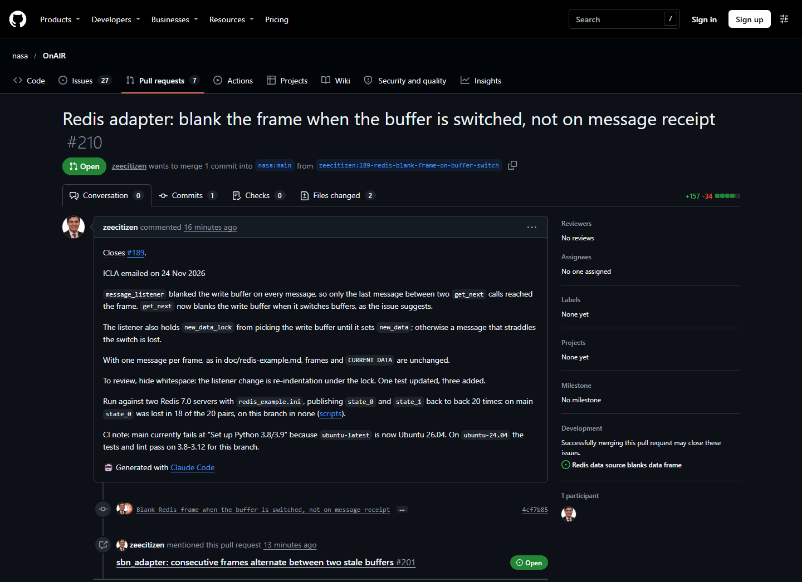
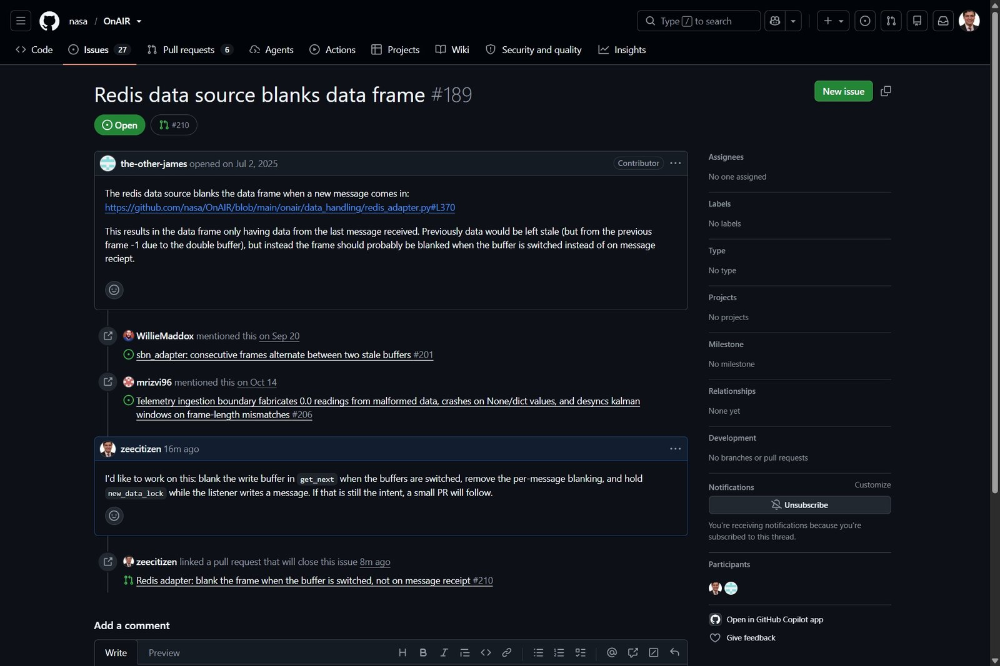
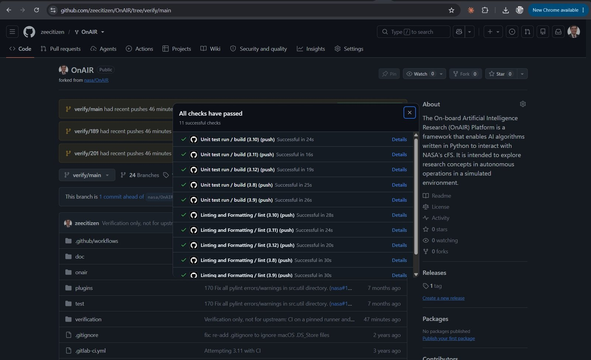



<div class="dexter-lab" markdown="1">

<span class="lab-badge">NASA OnAIR &middot; pull request open</span>

**A fix for a telemetry data-loss bug in NASA's OnAIR**, the open-source platform from NASA's Goddard Space Flight Center for running AI algorithms on spacecraft telemetry. The pull request was opened on 24&nbsp;November&nbsp;2026 and is awaiting review by the maintainers. It has not been merged.

<a class="lab-btn" href="https://github.com/nasa/OnAIR/pull/210">Pull request #210 on GitHub &rarr;</a>

<div class="lab-stats">
  <div class="lab-stat"><b>18 of 20 &rarr; 0</b><span>updates lost on real Redis, before &rarr; after</span></div>
  <div class="lab-stat"><b>374 tests</b><span>passing, 100% coverage</span></div>
  <div class="lab-stat"><b>Python 3.8&ndash;3.12</b><span>verified on Linux</span></div>
  <div class="lab-stat"><b>~10 lines</b><span>of source changed</span></div>
</div>

## The project

[OnAIR](https://github.com/nasa/OnAIR) (On-board Artificial Intelligence Research) is a Python pipeline that takes live telemetry from a spacecraft or a simulator and hands it, one frame at a time, to AI plugins that learn, plan and reason about it. NASA's [published account](https://doi.org/10.1002/aaai.70020) describes its use in research missions, including an experiment on a payload at the International Space Station.

The change described here is to the Redis data adapter in the open-source repository. It is not flight software, and nothing on this page has flown.

## The bug

OnAIR receives telemetry on a background thread and passes it to the pipeline in frames. The Redis adapter wiped its buffer every time a message arrived. So when two channels published between two frames, the second message erased the first before the pipeline ever saw it.

| | Channel A publishes | Channel B publishes | What the pipeline received |
|---|---|---|---|
| **Before** | x = 10 | x = 20 | A: *nothing*, B: 20 |
| **After** | x = 10 | x = 20 | A: 10, B: 20 |

A member of NASA's team had described the problem in [issue #189](https://github.com/nasa/OnAIR/issues/189) and suggested where the fix belonged: blank the buffer when the two buffers are swapped, not when a message arrives.

## The fix

Three lines in `get_next`, at the moment the buffers swap:

```python
with self.new_data_lock:
    self.new_data = False
    self.double_buffer_read_index = (self.double_buffer_read_index + 1) % 2
    read_index = self.double_buffer_read_index
    # turn all data points of the new write buffer to unknown
    write_buffer = self.current_data[(read_index + 1) % 2]
    write_buffer["data"] = ["-" for _ in write_buffer["data"]]
```

A frame now holds everything received since the previous frame, and the pipeline's existing logic keeps the older values. The per-message wipe is removed.

The second half is concurrency. The listener thread used to write its message without holding the lock. With blanking moved to the swap, a message caught half-way through a swap would have its second half written into a frame that had already been handed out, and lost. So the listener now holds the same lock for the whole message.

## How it was verified

- **Against real servers.** The project's own Redis example was run against two Redis 7.0 servers, with two channels publishing back to back 20 times. On the existing code the first channel's update was lost in 18 of the 20 pairs (20 of 20 in a second run). With the fix, none were lost in either run.
- **Tests that fail when they should.** One existing test encoded the bug and was corrected; three were added. All four fail against the old code. Three deliberately broken versions of the fix are each caught too: a nested lock, blanking in place, and setting the "new data" flag outside the lock.
- **A test for the deadlock nobody would see.** The existing tests replace the lock with a mock, so a version that takes the lock twice, and would freeze on the first real message, passes all of them. A new test asserts exactly one acquire, with the write inside it.
- **Under load.** With real threads and 20,000 messages under aggressive thread switching, the old code let 100 to 176 half-written messages into a frame per run. The fixed code let none. Those are stress conditions, not field rates.
- **The whole suite.** 374 tests pass with 100% statement and branch coverage, on Python 3.8 to 3.12 on Linux.

**Still pending:** NASA's own CI has not run on the pull request yet, because runs from first-time contributors wait for a maintainer's approval. The Linux results above are from my fork.

## Decisions that shaped it

- **The documentation settled the design.** The discussion around these adapters offered two approaches: blank the buffer, or carry old values forward inside the adapter. OnAIR's architecture document defines a frame as only the newly received data, and the pipeline already carries old values forward. Blanking at the swap is therefore the consistent fix, and it is the one NASA's team had suggested.
- **Small on purpose.** No refactoring, no new options, and the documentation page left alone. The pull request description is kept short.
- **One fix per pull request.** The same defect exists in mirror image in the adapter for NASA's cFS flight software ([issue #201](https://github.com/nasa/OnAIR/issues/201)): it never blanks, so consecutive frames alternate between two stale buffers. That fix is written and verified on my fork, with 374 tests passing on Python 3.8 to 3.12, but not submitted. The reporter of that issue prefers a different approach, so I [raised the design question there](https://github.com/nasa/OnAIR/issues/201#issuecomment-7146645822) first. It has not been run against cFS itself.
- **Found along the way.** NASA's CI has been failing on the main branch since 29 October 2026, because the hosted runner image no longer provides Python 3.8 or 3.9; the pull request notes it. One existing test also leaves a line uncovered about one run in ten, depending on a random number.

## How it was built

I work with an AI coding agent, and this contribution was built that way. The agent (Claude Code) did the code reading, wrote the change and its tests, and ran the verification. I chose the project and the issue, approved the approach, reviewed the change before it went out, signed NASA's contributor agreement and submitted the pull request myself. The commit lists Claude as co-author and the pull request says so, in line with the project's request that AI-assisted contributions are reviewed by a person.

## Status

- **Pull request [#210](https://github.com/nasa/OnAIR/pull/210):** open since 24 November 2026, awaiting maintainer review. NASA requires a signed contributor agreement, which I sent the same day.
- **Second fix (cFS/SBN adapter):** ready on my fork, to be submitted after the discussion on issue #201.

*Last updated 25 November 2026.*

## Screenshots

<div class="lab-gallery">
  <figure class="lab-shot"><a href="/images/opensource/onair-pr-210.png" target="_blank" rel="noopener"></a><figcaption>Pull request #210 on nasa/OnAIR &mdash; open, awaiting review &middot; click to enlarge</figcaption></figure>
  <figure class="lab-shot"><a href="/images/opensource/onair-issue-189.jpg" target="_blank" rel="noopener"></a><figcaption>Issue #189: the problem as NASA's team described it, my note of intent, and the linked pull request</figcaption></figure>
  <figure class="lab-shot"><a href="/images/opensource/onair-checks-redis-fix.jpg" target="_blank" rel="noopener"></a><figcaption>The fix on my fork: tests and lint on Python 3.8&ndash;3.12, plus the run against real Redis servers</figcaption></figure>
  <figure class="lab-shot"><a href="/images/opensource/onair-checks-baseline.jpg" target="_blank" rel="noopener"></a><figcaption>Baseline: NASA's unmodified code under the same checks (the Redis run here is the one that shows the loss)</figcaption></figure>
  <figure class="lab-shot"><a href="/images/opensource/onair-checks-sbn-fix.jpg" target="_blank" rel="noopener"></a><figcaption>The second fix (cFS/SBN adapter), not yet submitted: tests and lint on Python 3.8&ndash;3.12</figcaption></figure>
  <figure class="lab-shot"><a href="/images/opensource/onair-readme.jpg" target="_blank" rel="noopener"></a><figcaption>OnAIR's README. The red &ldquo;failing&rdquo; badge is NASA's own CI, broken by the runner change noted above</figcaption></figure>
</div>

</div>
