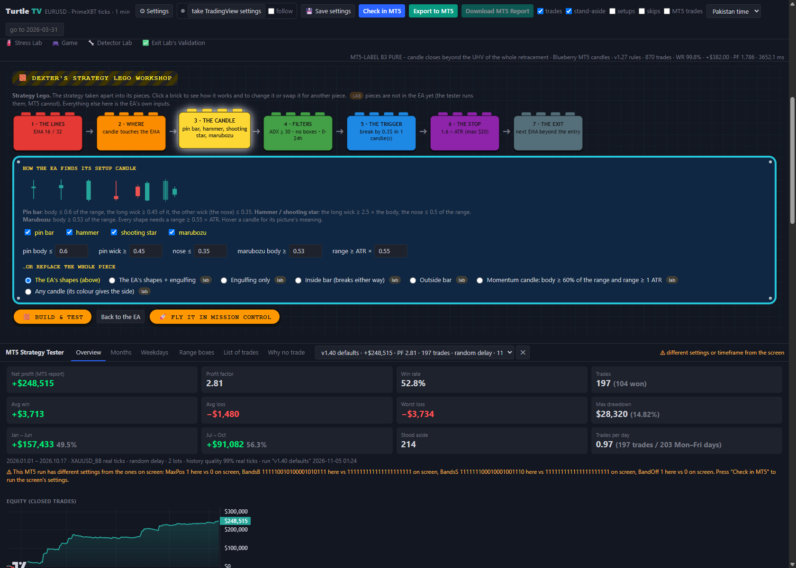
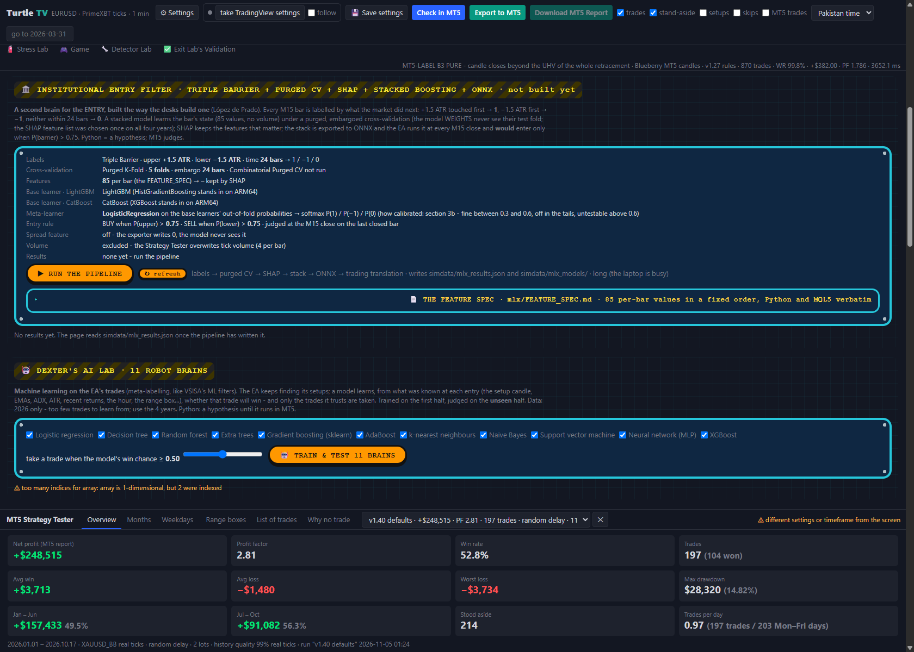

Turtle &middot; Algorithmic Trading Lab

**Turtle** is a live algorithmic-trading research platform I designed and built &mdash; and it is developed almost entirely through **agentic AI coding** (Claude Code), with me directing the architecture and reviewing every change. It ingests raw market tick data, builds candles, detects trading setups, backtests them against a **real MetaTrader&nbsp;5 execution engine**, trains machine-learning entry filters, and manages live orders with realistic bid/ask spread handling.

<a class="lab-btn" href="https://github.com/zeecitizen/turtle">View the code on GitHub &rarr;</a>

  
<b>4 years</b>of tick data replayed

  
<b>Python + MQL5</b>research &amp; EA stack

  
<b>MetaTrader 5</b>validated execution

  
<b>Agentic AI</b>built with Claude Code

## What it is

Not a toy backtester. Turtle is a full research-to-production loop for a trading strategy:

- **Real-time data pipeline** &mdash; ingests broker tick data, builds M1/M5/M15 candles, and keeps a synchronized view of several instruments.
- **Strategy tester** &mdash; a browser cockpit that replays years of ticks, scores a strategy on win rate, profit factor and drawdown, and surfaces every trade to inspect candle by candle.
- **Expert Advisors (MQL5)** &mdash; the automated strategies that run inside MetaTrader&nbsp;5, versioned from hypothesis to live deployment.
- **Machine-learning entry filter** &mdash; a second brain that decides which setups to take.
- **Live engine** &mdash; a Python service that reads live quotes over a browser bridge and manages positions.

## Inside the lab

  <figure class="lab-shot"><figcaption>Turtle TV &mdash; research dashboard &amp; strategy tester</figcaption></figure>
  <figure class="lab-shot"><figcaption>Trade Lifecycle &mdash; every path a trade takes, re-run in MT5</figcaption></figure>
  <figure class="lab-shot"><figcaption>Strategy Lego &mdash; the strategy taken apart into swappable pieces</figcaption></figure>
  <figure class="lab-shot"><figcaption>ML entry filter &mdash; triple-barrier labels, purged CV, ONNX</figcaption></figure>
  <figure class="lab-shot"><figcaption>Golden Gravity &mdash; a game on the same live market engine</figcaption></figure>

## The engineering discipline that matters most

The hard lesson baked into the whole project: **a naive Python backtest lies.** It fills at the price it wants, with no spread, slippage, latency or requotes, and it asks "did the low reach my stop?" using the very candle it is trading inside &mdash; so the answer is baked into the question.

So Turtle treats a Python result as a **hypothesis only**, and promotes a strategy only when it survives **MetaTrader&nbsp;5's own Strategy Tester**, with random execution delay and the target held at the broker. To get fast iteration without losing that rigour, I built an internal tester and then **validated it against 16 MT5 runs (52,000+ trades)** with an automated parity check before trusting it to stand in for MT5. That "validate against reality, never against a simulation of your own making" rule is the backbone of the system &mdash; and it is the same instinct I bring to production software: trust measured behaviour, not assumptions.

## The machine-learning layer

The entry filter is built the way quant desks build one (after Lopez de Prado), not the way tutorials do:

- **Triple-barrier labelling** &mdash; each bar is labelled by what the market did next (an upper or lower barrier touched first within a time limit).
- **Purged, embargoed cross-validation** &mdash; so the model's weights never see their own test fold and results don't leak across time.
- **A stacked ensemble** &mdash; gradient-boosted base learners (LightGBM, CatBoost) with a logistic meta-learner, feature-selected with SHAP.
- **Exported to ONNX** &mdash; so the exact model runs inside the MQL5 Expert Advisor at every bar close.

A companion lab trains eleven different classifiers (random forest, SVM, neural net, XGBoost and more) as meta-labels on the strategy's own trades &mdash; and, true to the discipline above, every one of them is a hypothesis until it runs in MT5.

## Architecture

A tick ingester feeds a candle builder; a detection engine scans for setups; the tester replays history through the **same** detection code that runs live, so research and production never drift apart. Background workers watch the market, collect fills and report. Dashboards are served by lightweight Python web servers and driven live through the Chrome DevTools Protocol.

## Tech

Python &middot; MQL5 / MetaTrader&nbsp;5 &middot; real-time tick processing &middot; NumPy / pandas &middot; scikit-learn / LightGBM / CatBoost / ONNX &middot; Flask web dashboards &middot; WebSocket &amp; Chrome DevTools Protocol automation &middot; SQLite &middot; agentic AI development (Claude Code)

