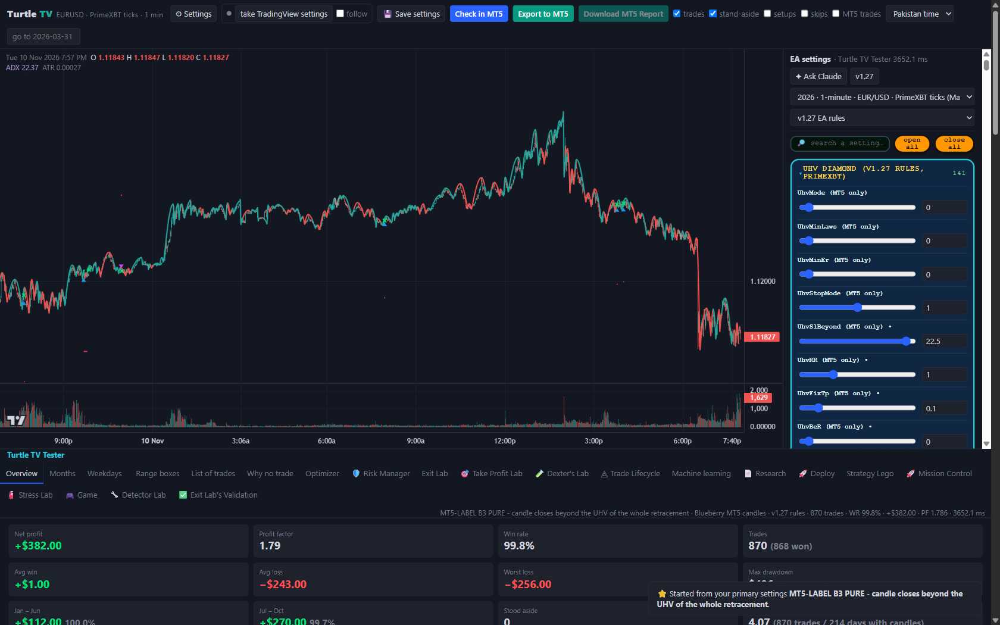
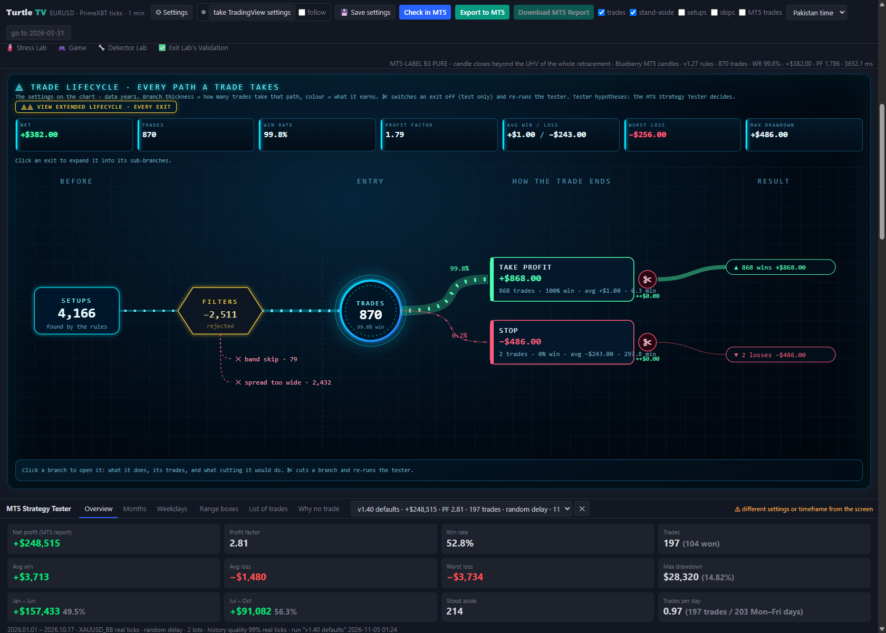

Turtle &middot; Algorithmic Trading Lab

**Turtle** is a live algorithmic-trading research platform I designed and built &mdash; and it is developed almost entirely through **agentic AI coding** (Claude Code), with me directing the architecture and reviewing every change. It ingests raw market tick data, builds candles, detects trading setups, backtests them against a **real MetaTrader&nbsp;5 execution engine**, and manages live orders with realistic bid/ask spread handling. A machine-learning entry filter is in research (below).

<a class="lab-btn" href="https://github.com/zeecitizen/turtle">View the code on GitHub &rarr;</a>

*What's proven here is the validation harness that catches simulation lies. The trading edge itself is still under test &mdash; and the honesty about that is the point.*

  
<b>52,782</b>trades in the parity check

  
<b>Python + MQL5</b>research &amp; EA stack

  
<b>MetaTrader 5</b>the promotion gate

  
<b>Agentic AI</b>built with Claude Code

## What it is

Not a toy backtester. Turtle is a full research-to-production loop for a trading strategy:

- **Real-time data pipeline** &mdash; ingests broker tick data, builds M1/M5/M15 candles, and keeps a synchronized view of several instruments.
- **Strategy tester** &mdash; a browser cockpit that replays years of ticks, scores a strategy on win rate, profit factor and drawdown, and surfaces every trade to inspect candle by candle.
- **Expert Advisors (MQL5)** &mdash; the automated strategies that run inside MetaTrader&nbsp;5, versioned from hypothesis to live deployment.
- **Machine-learning entry filter** &mdash; a second brain being trained to score setups (in research; ships off by default).
- **Live engine** &mdash; a Python service that reads live quotes over a browser bridge and manages positions.

## Inside the lab

  <figure class="lab-shot"><figcaption>Turtle TV &mdash; research dashboard &amp; strategy tester &middot; click to enlarge</figcaption></figure>
  <figure class="lab-shot"><figcaption>Trade Lifecycle &mdash; every path a trade takes, re-run in MT5</figcaption></figure>
  <figure class="lab-shot"><figcaption>Strategy Lego &mdash; the strategy taken apart into swappable pieces</figcaption></figure>
  <figure class="lab-shot"><figcaption>ML entry filter &mdash; triple-barrier labels, purged CV, ONNX</figcaption></figure>
  <figure class="lab-shot"><figcaption>Golden Gravity &mdash; a game on the same live market engine</figcaption></figure>

## The engineering discipline that matters most

The lesson the whole project is built around: **a naive Python backtest lies.** Early on, a Python replay of **163 real entries predicted +$876** &mdash; the same trades, filled for real, returned **&minus;$657**. A tick-door simulation promised an 89% win rate; live fills gave 57%. Python fills at the price it wants, with no spread, slippage, latency or requotes, and it asks "did the low reach my stop?" using the very candle it is trading inside &mdash; so the answer is baked into the question.

So Turtle treats a Python result as a **hypothesis only**, and promotes a setting only when it survives **MetaTrader&nbsp;5's own Strategy Tester** (random execution delay, target held at the broker). To keep fast iteration without losing that rigour, I built an internal tester and then **validated it against 16 MT5 runs &mdash; 52,782 trades &mdash; with an automated parity check** before trusting it to stand in for MT5. That rule &mdash; *validate against reality, never against a simulation of your own making* &mdash; is the backbone of the system, and the same instinct I bring to production software.

> **What the AI got wrong, and I caught.** The AI-written tester once filled *moved* stops (break-even, trailing) at the entry tick instead of when price actually reached them &mdash; a look-ahead bug that silently flattered the results. I caught it in review; the fix searches the real tick stream forward from each entry. Agentic AI writes the code fast, but the judgement about what is *correct* stays with the engineer.

## The machine-learning layer

A second entry filter is **architected** the way quant desks build one (after L&oacute;pez de Prado), not the way tutorials do:

- **Triple-barrier labelling** &mdash; each bar labelled by what the market did next (an upper or lower barrier touched first within a time limit).
- **Purged, embargoed cross-validation** &mdash; so the model never sees its own test fold and results don't leak across time.
- **A stacked ensemble** &mdash; gradient-boosted base learners (LightGBM, CatBoost) with a logistic meta-learner, feature-selected with SHAP.
- **ONNX export** &mdash; so the trained model *can* run inside the MQL5 Expert Advisor at bar close, once it earns promotion.

**Honest status: this filter ships disabled by default.** It has not yet beaten the MT5 baseline out of sample &mdash; its gate sits inside the random band &mdash; so by the project's own promotion rule it stays off until it does. A companion lab trains eleven classifiers (random forest, SVM, neural net, XGBoost and more) as meta-labels on the strategy's own trades, every one a hypothesis until it clears MT5. Building the apparatus and *refusing to switch it on until it proves an edge* is the discipline, not a gap in it.

## Architecture

A tick ingester feeds a candle builder; a detection engine scans for setups. The Python research tester and the live **MQL5 Expert Advisors** are two implementations of the strategy, kept in lock-step by an **automated parity check** (validated across 16 MT5 runs / 52,782 trades) so research and production stay aligned. Background workers watch the market, collect fills and report. Dashboards are served by lightweight **Python web servers** (standard-library `http.server`) and driven live through the Chrome DevTools Protocol.

## Tech

Python &middot; MQL5 / MetaTrader&nbsp;5 &middot; real-time tick processing &middot; NumPy / pandas &middot; scikit-learn / LightGBM / CatBoost / ONNX &middot; standard-library HTTP dashboards &middot; WebSocket &amp; Chrome DevTools Protocol automation &middot; SQLite &middot; agentic AI development (Claude Code)

