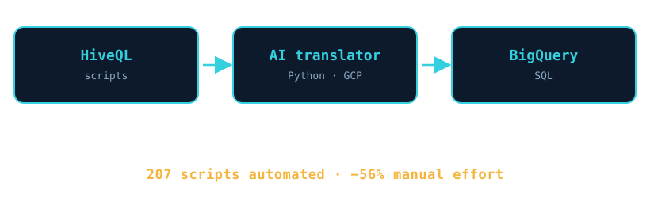

**Context.** A major bank was moving its on-premise Hadoop/Hive data platform to Google Cloud. Thousands of HiveQL scripts had to be rewritten in BigQuery SQL &mdash; by hand this is slow, repetitive and easy to get subtly wrong.

**What I did.** Designed and built a web-based tool that translates HiveQL into BigQuery SQL, combining rule-based transforms with LLM-assisted rewriting and a validation step, so an engineer reviews and accepts each result rather than trusting a black box.

**Result.** Automated the translation of **207 scripts** and cut manual translation effort by **56%**, letting the migration team move far faster while keeping a human in the loop for correctness.

**Tech:** Python, Google Cloud Platform (BigQuery), LLM-based tooling, web backend + UI.

*Client project &mdash; the diagram is a sanitized overview; code and screens are confidential.*
