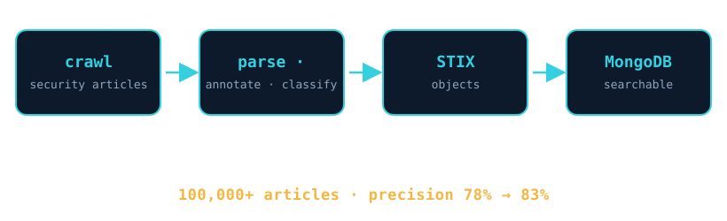

**Context.** At Huawei's German Research Center, the Big Data Threat Analysis team needed to turn the firehose of public security writing into structured, queryable threat intelligence.

**What I did.** Built an end-to-end pipeline that crawls security articles, parses and annotates them, and classifies the content into **STIX** objects (the standard format for cyber-threat intelligence). A human-in-the-loop stage lets analysts correct the model, and that feedback raised classification precision from **78% to 83%** over **100,000+** articles. I migrated storage from flat files to **MongoDB**, making every article searchable in seconds, and turned the research prototype into production-ready, documented code &mdash; batch processing, scheduled jobs, failure monitoring and retry, RBAC and versioning included.

**Tech:** Python, Flask, NLP, MongoDB, scheduled batch processing.

*Research project at Huawei (via Hays) &mdash; sanitized overview.*
