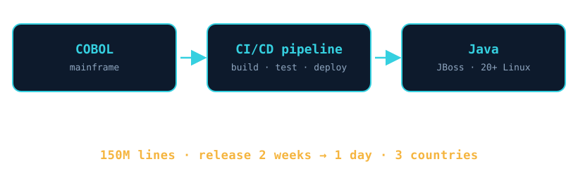

**Context.** One of the world's largest mainframe-modernisation programmes: migrating **150 million lines** of COBOL running on a mainframe to Java on commodity servers.

**What I did.** As **CI/CD team lead**, I designed and built the continuous-integration and delivery pipelines that compile, test and deploy the migrated Java, and coordinated the infrastructure across teams in the **Netherlands, Belgium and the USA**. Applications deployed to JBoss and batch jobs to 20+ Linux servers. I led a team of **five developers** through to a successful go-live.

**Result.** Release time dropped from **two weeks to one day** &mdash; each release a series of safe, repeatable, observable steps rather than a risky big-bang.

**Tech:** Azure DevOps, Maven, Bash, JBoss, Linux.

*Client project &mdash; sanitized overview.*
